 

## 🃏 &nbsp;Featured work

<a href="https://github.com/adriennie/Sentinel-cli">Sentinel-cli</a> ·
<a href="https://github.com/adriennie/log-triage">log-triage</a> ·
<a href="https://github.com/adriennie/vllm-pagedattention-benchmark">vllm-pagedattention-benchmark</a> ·
<a href="https://github.com/adriennie/vllm-lora-extension">vllm-lora-extension</a>

## 🧰 &nbsp;Toolbox

 

## 🎖️ &nbsp;Certifications & recognition

## 📈 &nbsp;Activity

## 👋 &nbsp;Say hello

If you're building something where the model is only half the problem (evaluation, serving, data, observability), I'm always happy to talk shop. Find me on [LinkedIn](https://www.linkedin.com/in/adrika-pradhan-3a92622ba/) or at **adrika.pradhan@usi.ch**.

